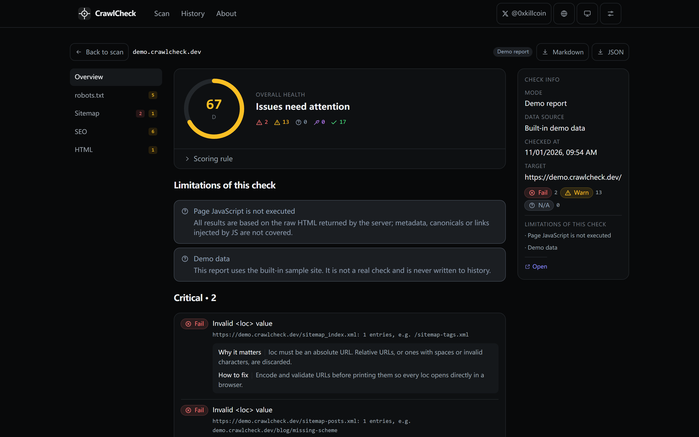
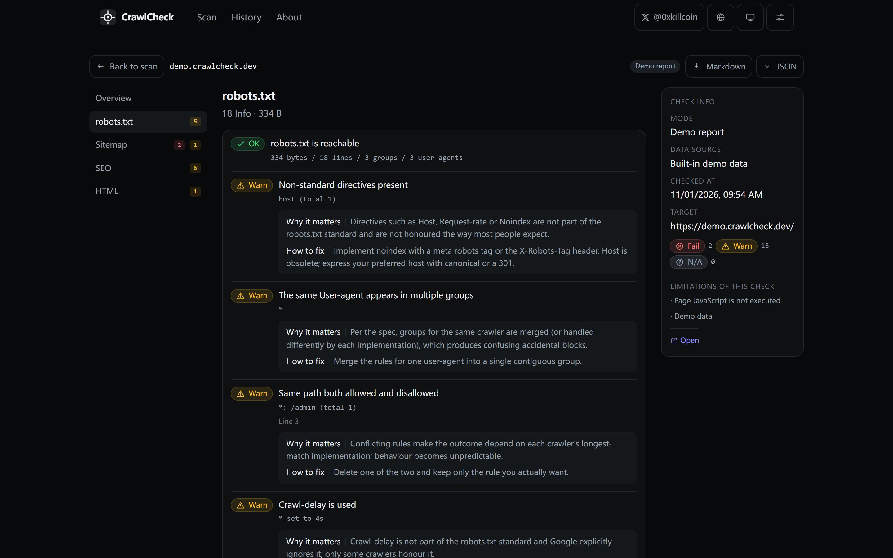
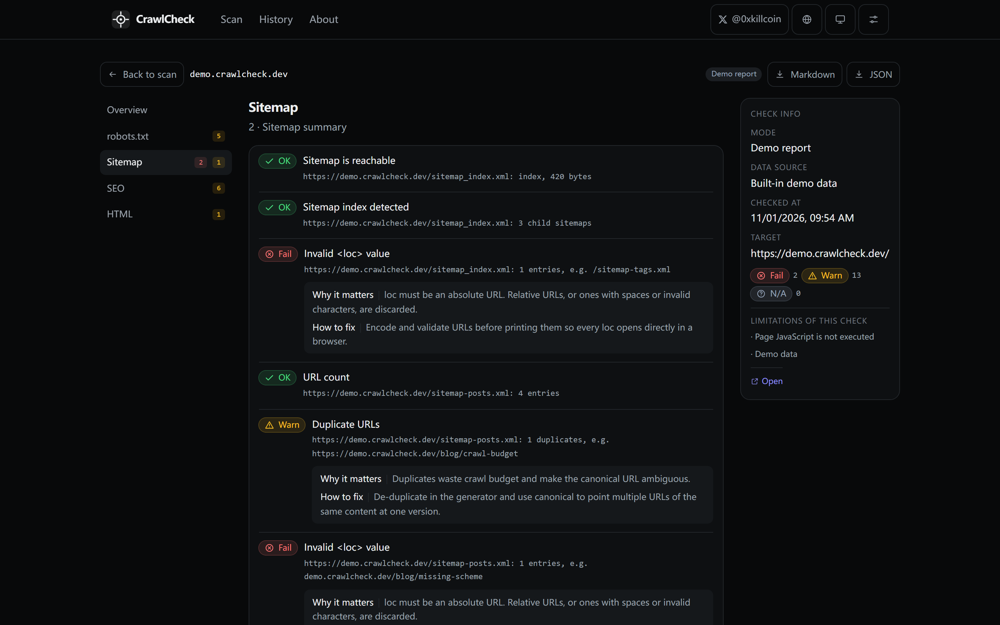
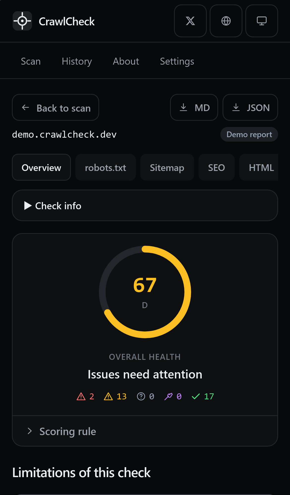
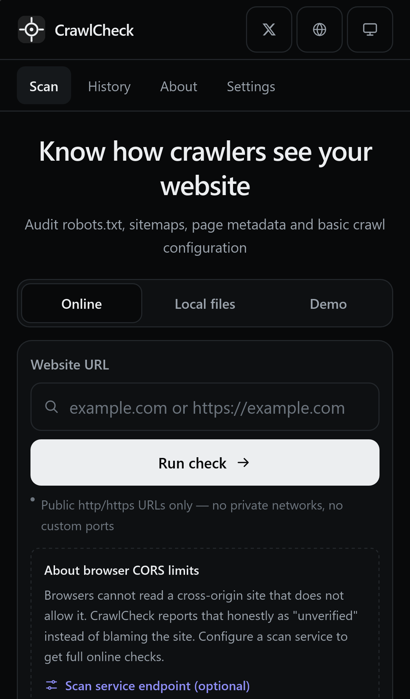

<div align="right">

**English** · [简体中文](./README.zh-CN.md)

</div>

<h1 align="center">CrawlCheck</h1>

<p align="center"><strong>Know how crawlers see your website.</strong><br/>
A local-first technical SEO and crawl-configuration checker for robots.txt, sitemaps, page metadata and canonical signals.</p>

<p align="center">
  <a href="https://iiiiiiiiiiiiiKK.github.io/crawlcheck/"></a>
  <a href="https://github.com/iiiiiiiiiiiiiKK/crawlcheck/actions/workflows/ci.yml"></a>
  <a href="https://github.com/iiiiiiiiiiiiiKK/crawlcheck/blob/main/LICENSE"></a>
  <a href="https://x.com/0xkillcoin"></a>
</p>

<p align="center">
  
</p>

---

## Table of contents

- [Why CrawlCheck](#why-crawlcheck)
- [Live demo](#live-demo)
- [Features](#features)
- [What it deliberately does not do](#what-it-deliberately-does-not-do)
- [Quick start](#quick-start)
- [The two scan modes](#the-two-scan-modes)
- [CORS: why the browser cannot always scan a site](#cors-why-the-browser-cannot-always-scan-a-site)
- [The optional scan service (Cloudflare Worker)](#the-optional-scan-service-cloudflare-worker)
- [SSRF protection](#ssrf-protection)
- [Health score](#health-score)
- [Project structure](#project-structure)
- [Testing](#testing)
- [Deployment](#deployment)
- [Privacy](#privacy)
- [Known limitations](#known-limitations)
- [Roadmap](#roadmap)
- [License](#license)

## Why CrawlCheck

Most "SEO checkers" are lead-generation pages: they ask for your domain, hide the reasoning, and treat every failure to fetch as *your* mistake. CrawlCheck takes the opposite approach:

- **Every result is explainable.** Each finding carries *what we saw*, *why it matters* and *how to fix it*.
- **"I could not check it" is a first-class result.** A check ends in one of five states — pass, warning, error, **unverified**, **tool error** — and unverified items are never counted as passing.
- **Files never leave your machine.** The local mode parses robots.txt, sitemaps and HTML entirely in the browser.
- **No accounts, no ads, no trackers, no server-side storage.**

## Live demo

> **https://iiiiiiiiiiiiiKK.github.io/crawlcheck/**

The demo report (`Demo` tab) runs a built-in sample site through the *real* analyser, so you can see a full report without entering a URL. Demo reports are labelled and never written to your history.

## Features

| Area | What CrawlCheck checks |
| --- | --- |
| **robots.txt** | Existence, group parsing by `User-agent`, `Allow`/`Disallow` (wildcards preserved), `Sitemap`, `Crawl-delay`, whole-site `Disallow: /`, conflicting rules, orphan rules, duplicate groups, malformed lines, non-standard directives, relative sitemap URLs |
| **Sitemaps** | `urlset` and `sitemapindex` parsing, `loc`/`lastmod`, XML validity, duplicate URLs, empty `loc`, invalid or relative URLs, cross-host entries, 50,000-URL limit, missing `lastmod`, child sitemaps (one level, capped), robots.txt declaration |
| **Page / SEO** | Title (presence, length, duplicates), meta description, H1 count, canonical (presence, validity, cross-origin, duplicates), robots meta (`noindex`), `html lang`, viewport (missing / fixed width / zoom blocked), Open Graph, X card |
| **HTML** | Charset, DOCTYPE, images without `alt`, internal vs external link counts, headings outline, JSON-LD count, page weight |
| **URL / transport** | URL validation, HTTP vs HTTPS, status code, redirect chain, content type |
| **Product** | Health score with published rules, local history (IndexedDB → localStorage fallback), reopen history, delete one / clear all, JSON export, Markdown export, built-in demo, Chinese/English UI, light/dark/system themes, mobile layout |

<p align="center">
  
  
</p>
<p align="center">
  
  
</p>

## What it deliberately does not do

Being explicit about this is the point:

- **No JavaScript rendering.** Findings are based on the HTML the server returns. Anything injected by client-side JS is out of scope, and the report says so.
- **No site crawling.** Only the entry page plus `/robots.txt` and sitemaps are fetched — never an arbitrary path, port or directory.
- **No indexing or ranking data.** CrawlCheck cannot tell you whether a URL is indexed by a search engine, and does not pretend to.
- **No "pass" for things it did not check.** If a resource could not be read, the related checks are reported as *unverified*, and the score either excludes them or refuses to produce a number.

## Quick start

```bash
# Node.js >= 20 and pnpm are required
pnpm install
pnpm dev          # http://localhost:5173/crawlcheck/

pnpm test         # 175 unit + security tests
pnpm build        # typecheck + production build into dist/
pnpm serve        # serve dist/ at http://127.0.0.1:4173/crawlcheck/
pnpm e2e          # Playwright: desktop Chromium + iPhone WebKit
```

The build is a static bundle — no backend is required for the local-file mode, the demo, history, or exports.

## The two scan modes

### Mode A — local files (always available, fully offline)

Paste or upload `robots.txt`, `sitemap.xml` and an HTML file. Parsing happens in your browser; no request leaves the page. Local results are labelled *Local file check* and are kept separate from online results in the history.

### Mode B — online scan

Type a URL and CrawlCheck tries to read the home page, `/robots.txt` and up to three sitemaps from the site itself:

- **Direct mode** (default): a plain browser `fetch`. Works when the target sends permissive CORS headers.
- **Scan-service mode**: if you configure an endpoint (Settings → scan service), the request goes to your own CrawlCheck Worker, which fetches server-side with full SSRF protection.

Either way the same analyser produces the report, so a local result and an online result can never disagree about how a file is parsed.

## CORS: why the browser cannot always scan a site

A browser may not read a cross-origin response unless the target server allows it. Most sites do not. CrawlCheck treats this as **"unverified — browser CORS restriction"**, not as a problem with the site, and offers two honest ways forward:

1. configure your own scan service (see below), or
2. switch to local file mode and paste the source.

This is exactly why the online mode is designed as an optional, self-hostable service instead of a pretend-fix (an open CORS proxy).

## The optional scan service (Cloudflare Worker)

`worker/` contains a small Cloudflare Worker that turns CrawlCheck into a fully server-side scanner.

```bash
cd worker
npx wrangler deploy
```

Then paste the deployed URL (for example `https://crawlcheck-scan.<account>.workers.dev`) into **Settings → scan service**. The static app and the Worker ship in the same repository; the Worker reuses the same parsers and the same SSRF guard as the app.

Configuration (`worker/wrangler.toml`, or Worker environment variables):

| Variable | Default | Meaning |
| --- | --- | --- |
| `ALLOWED_ORIGINS` | `*` | Comma-separated list of browser origins allowed to call `/scan`. Lock this to your Pages origin for a private deployment. |
| `RATE_LIMIT_MAX` | `30` | Requests allowed per client IP per window. |
| `RATE_LIMIT_WINDOW_SEC` | `600` | Rate-limit window in seconds. |

Endpoints: `GET /health` (liveness) and `POST /scan` with `{ "url": "https://example.com" }`.

**Free-tier reality check:** Workers' free plan allows 100k requests/day with a low CPU-time budget. A scan uses at most 8 outbound requests and 8 seconds per request, which fits comfortably for personal or small-community use. The rate limiter is in isolate memory, so it is a soft limit — see [Known limitations](#known-limitations).

## SSRF protection

The scan service is the only component that fetches URLs on a user's behalf, so the guard is deliberately paranoid (see `src/lib/ssrf.ts`, `worker/src/scan.ts` and `tests/ssrf.test.ts`):

| Risk | Mitigation |
| --- | --- |
| Non-HTTP protocols | Only `http:` / `https:` are accepted; `file:`, `ftp:`, `data:`, `javascript:` are rejected |
| Loopback / private networks | IPv4 `127/8`, `10/8`, `172.16/12`, `192.168/16`, `169.254/16`, `100.64/10`, `0/8`, multicast, reserved ranges are blocked |
| IPv6 | `::1`, `fc00::/7`, `fe80::/10`, `ff00::/8`, IPv4-mapped and NAT64 forms are classified through the embedded IPv4 |
| Alternative IP encodings | Decimal (`2130706433`), octal (`0177.0.0.1`), hex (`0x7f000001`) and short (`127.1`) forms are normalised before classification |
| Cloud metadata | `169.254.169.254`, `metadata.google.internal`, `instance-data` and friends are refused |
| Internal host names | `localhost`, `*.localhost`, `*.local`, `*.internal`, `*.home.arpa`, `*.svc`, `*.cluster.local`, RFC 2606 TLDs |
| DNS rebinding | Every DNS answer is resolved (DoH) and validated; **one** private answer aborts the request |
| Redirect to internal host | Each redirect hop is re-validated (URL **and** DNS), max 3 hops |
| Unbounded response | Bodies are streamed with a 512 KB cap; larger responses are truncated and flagged |
| Slow responses | 8 s timeout per request |
| Request amplification | Max 8 outbound requests per scan; sitemap indexes expand exactly one level, max 3 children, same host only |
| Open proxy abuse | The service only ever requests `/`, `/robots.txt`, sitemap URLs declared by the site (same host) and child sitemaps of an index. There is no API for arbitrary paths, ports or hosts |
| Abuse volume | Per-IP rate limit, 4 KB request body cap, CORS allow-list, `POST` only |

## Health score

The rule is published in the UI and in every export:

```
score = round(100 × (Σ weight(pass) + 0.5 × Σ weight(warn)) ÷ Σ weight(pass | warn | fail))
```

- `unverified` and tool-error findings are removed from **both** numerator and denominator — they can neither help nor hurt.
- If the unverifiable weight is at least the scorable weight, CrawlCheck refuses to print a number and shows `—`.
- Grades: **A** ≥ 90, **B** ≥ 80, **C** ≥ 70, **D** ≥ 60, **E** ≥ 40, otherwise **F**.

## Project structure

```
src/
  lib/            pure logic: url, ssrf, robots, sitemap, html, analysis, score, export, history, demo
  i18n/           zh/en catalogues (UI + every finding's title / current / why / fix)
  components/     header, scan form, findings, primitives, settings
  views/          scan, report (overview / robots / sitemap / seo / html), history, about
  state/          persisted preferences (theme, language, scan endpoint)
worker/           optional Cloudflare Worker scan service (same parsers, same SSRF guard)
tests/            Vitest unit + security tests
e2e/              Playwright desktop + iPhone WebKit tests
scripts/          static server for previews/tests, screenshot capture
docs/screenshots/ screenshots used above (captured from the real build)
```

## Testing

```bash
pnpm typecheck   # TypeScript, strict, noUnusedLocals
pnpm test        # Vitest: 175 tests in 10 files
pnpm build       # production build
pnpm e2e         # Playwright: 12 desktop + 5 iPhone scenarios
```

What is covered:

- **Parsers:** robots.txt groups/wildcards/comments/BOM/CRLF/conflicts/orphans/duplicates; sitemap `urlset` + `sitemapindex`, malformed XML, wrong root, duplicates, empty and relative `loc`.
- **HTML:** title/description/canonical/robots/OG/X card/lang/viewport/charset, image alt, internal vs external links, heading outline.
- **Honesty rules:** CORS-blocked and not-checked resources must be `unverified`, never `pass`; the score must not be produced when too much is unverified.
- **Security:** every blocked range and encoding above, DNS rebinding, redirect-to-metadata, oversized bodies, timeouts, request budget, and the fact that only well-known paths are ever requested.
- **Product:** history (save/list/delete/clear, demo report excluded), JSON + Markdown export, demo report consistency.
- **Browsers:** desktop Chromium and iPhone 13 WebKit, including a no-horizontal-scroll assertion, 44 px tap targets and 16 px input font (iOS zoom).

## Deployment

### GitHub Pages (used by this repository)

`.github/workflows/deploy.yml` builds on every push to `main` and publishes `dist/` to Pages. One-time setup: **Settings → Pages → Build and deployment → Source: GitHub Actions**.

### Other static hosts

`pnpm build` produces a self-contained `dist/`. Set `VITE_BASE=/` when serving from a domain root:

```bash
VITE_BASE=/ pnpm build
```

### Scan service

```bash
cd worker
npx wrangler deploy
```

or add the Worker as a second GitHub Actions target. Then set the endpoint either in the app's settings or at build time with `VITE_SCAN_ENDPOINT` (see `.env.example`).

## Privacy

- Local mode: files are parsed in your browser and never uploaded.
- History: stored in IndexedDB (localStorage as a fallback) in *your* browser. Nothing is synced.
- No analytics, no advertising, no third-party fonts or scripts.
- The scan service logs nothing beyond what Cloudflare provides by default; it does not persist scan results.

## Known limitations

- **CORS** — direct-mode online scans only work against sites that allow cross-origin reads. This is a browser rule, not a CrawlCheck bug.
- **Worker rate limiting is per isolate** — a soft limit, not a global quota. For strict quotas, put Cloudflare's rate-limiting product or a Durable Object in front.
- **One page per scan** — internal pages are not crawled (by design).
- **No JS rendering** — single-page apps whose metadata is injected at runtime will look incomplete in the SEO section; the report flags that JavaScript was not executed.
- **Heuristic thresholds** — title 15–60 characters and description 50–160 characters are recommendations, not ranking factors.
- **Sitemap fetching is capped** — at most 3 sitemaps and 3 children, one index level, same host only.
- **Score excludes unverifiable work** — by design, so a blocked scan cannot pretend to be a healthy site.

## Roadmap

- [ ] Optional rendered-DOM check via the Worker (headless rendering) behind an explicit flag
- [ ] Compare two scans of the same host over time
- [ ] `hreflang` matrix validation
- [ ] Shareable, signed report links (no server-side storage)

## License

[MIT](./LICENSE) © 2026 [0xkillcoin](https://x.com/0xkillcoin)

Third-party dependencies: React, Vite, Tailwind CSS, Vitest, Playwright, jsdom — all MIT or Apache-2.0 licensed. No runtime dependency is required for parsing, and the Worker has no dependencies at all.

---

<p align="center">
  Built by <a href="https://x.com/0xkillcoin">@0xkillcoin</a> ·
  <a href="https://iiiiiiiiiiiiiKK.github.io/crawlcheck/">Live demo</a> ·
  <a href="https://github.com/iiiiiiiiiiiiiKK/crawlcheck/issues">Issues</a>
</p>
