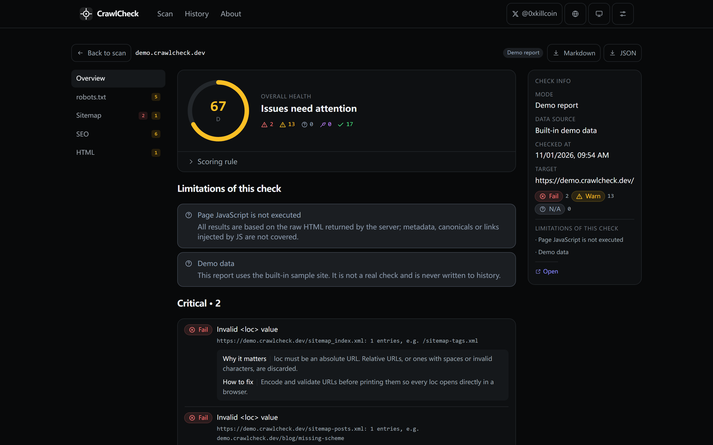
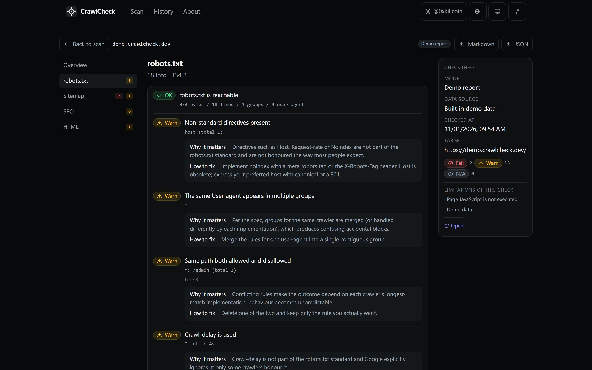
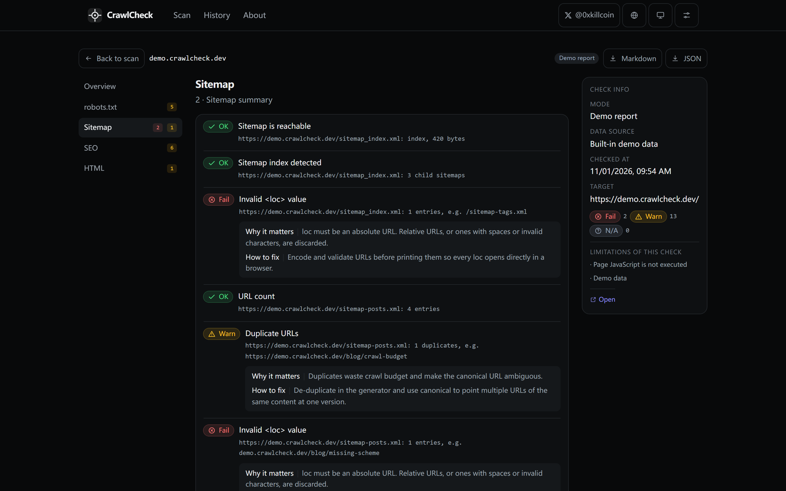
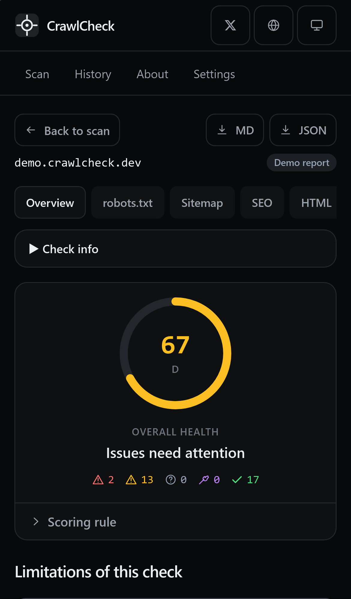
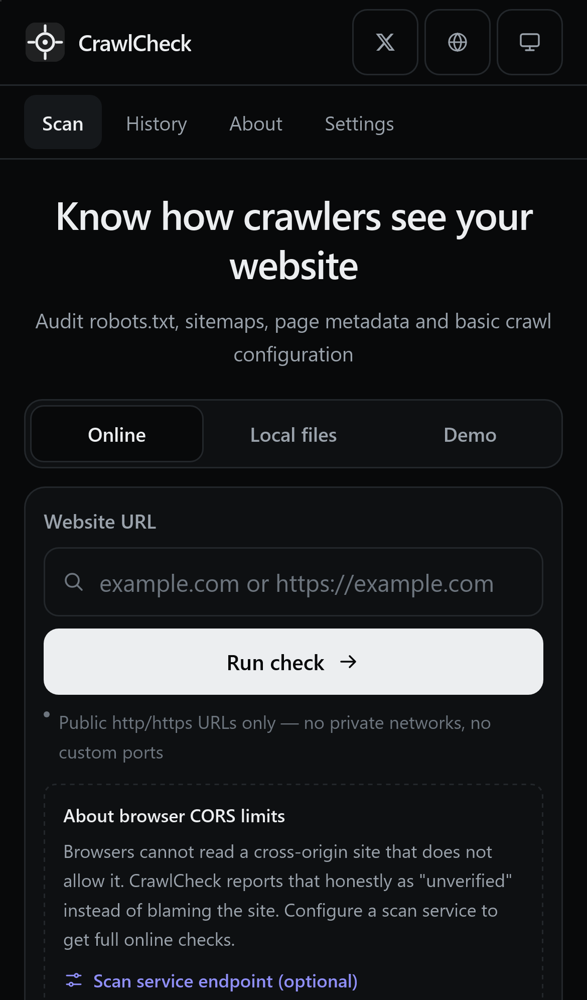

<div align="right">

[English](./README.md) · **简体中文**

</div>

<h1 align="center">CrawlCheck</h1>

<p align="center"><strong>看看搜索引擎眼中的你。</strong><br/>
一个默认本地解析的网站技术配置体检工具：robots.txt、sitemap、页面 meta 与 canonical。</p>

<p align="center">
  <a href="https://iiiiiiiiiiiiiKK.github.io/crawlcheck/"></a>
  <a href="https://github.com/iiiiiiiiiiiiiKK/crawlcheck/actions/workflows/ci.yml"></a>
  <a href="https://github.com/iiiiiiiiiiiiiKK/crawlcheck/blob/main/LICENSE"></a>
  <a href="https://x.com/0xkillcoin"></a>
</p>

<p align="center">
  
</p>

---

## 目录

- [为什么做 CrawlCheck](#为什么做-crawlcheck)
- [在线演示](#在线演示)
- [功能](#功能)
- [它刻意不做什么](#它刻意不做什么)
- [快速开始](#快速开始)
- [两种检查模式](#两种检查模式)
- [CORS：为什么浏览器不一定能检查](#cors为什么浏览器不一定能检查)
- [可选检查服务（Cloudflare Worker）](#可选检查服务cloudflare-worker)
- [SSRF 防护](#ssrf-防护)
- [健康度评分](#健康度评分)
- [项目结构](#项目结构)
- [测试](#测试)
- [部署](#部署)
- [隐私](#隐私)
- [已知限制](#已知限制)
- [路线图](#路线图)
- [许可证](#许可证)

## 为什么做 CrawlCheck

很多"SEO 检测工具"本质是获客页面：先要你的域名，再把推理藏起来，还把"抓取失败"当成你的网站有问题。CrawlCheck 反着来：

- **每个结果都能解释。** 每条发现都带有「当前结果」「为什么重要」「如何修复」。
- **"我没法检查"是一等结果。** 检查只有五种状态：正常、警告、错误、**无法验证**、**检查工具出错**。无法验证的项目永远不会被计为通过。
- **文件不离开你的设备。** 本地模式完全在浏览器内解析 robots.txt、sitemap 与 HTML。
- **没有账号、没有广告、没有追踪、没有服务端存储。**

## 在线演示

> **https://iiiiiiiiiiiiiKK.github.io/crawlcheck/**

「演示」标签页会把内置示例站点送进**真实的**分析器，因此你不输入任何网址也能看到完整报告。演示报告有明确标注，且永远不会写入历史记录。

## 功能

| 模块 | 检查内容 |
| --- | --- |
| **robots.txt** | 是否存在；按 `User-agent` 分组解析；`Allow`/`Disallow`（保留通配符）；`Sitemap`、`Crawl-delay`；整站 `Disallow: /`；冲突规则、孤立规则、重复分组、格式错误行、非标准指令、相对 sitemap 地址 |
| **Sitemap** | `urlset` 与 `sitemapindex` 解析；`loc`/`lastmod`；XML 有效性；重复 URL；空 `loc`；无效或相对地址；跨域地址；5 万条上限；全部缺少 `lastmod`；子 sitemap（仅一层、数量受限）；是否在 robots.txt 中声明 |
| **页面 / SEO** | 标题（存在性、长度、重复）；描述；H1 数量；canonical（存在性、有效性、跨域、重复）；robots meta（`noindex`）；`html lang`；viewport（缺失 / 固定宽度 / 禁止缩放）；Open Graph；X Card |
| **HTML** | 字符集、DOCTYPE、缺少 `alt` 的图片、内链与外链数量、标题层级、JSON-LD 数量、页面体积 |
| **URL / 传输** | URL 校验、HTTP 与 HTTPS、状态码、跳转、Content-Type |
| **产品** | 公开规则的健康度评分；本地历史（IndexedDB，降级到 localStorage）；重开历史；删除单条 / 清空；JSON 导出；Markdown 导出；内置演示；中英双语；深色/浅色/跟随系统；移动端布局 |

<p align="center">
  
  
</p>
<p align="center">
  
  
</p>

## 它刻意不做什么

把边界说清楚本身就是设计的一部分：

- **不执行 JavaScript。** 所有结论基于服务器返回的 HTML；由前端 JS 注入的 meta 不在范围内，报告里会明确说明。
- **不爬取整站。** 只请求入口页、`/robots.txt` 与 sitemap，从不请求任意目录、端口或主机。
- **不提供收录与排名数据。** CrawlCheck 无法判断某个 URL 是否已被搜索引擎收录，也不会假装可以。
- **没查过的项目不打勾。** 资源读取失败时，相关检查标记为「无法验证」，评分要么排除它们，要么干脆不给分数。

## 快速开始

```bash
# 需要 Node.js >= 20 与 pnpm
pnpm install
pnpm dev          # http://localhost:5173/crawlcheck/

pnpm test         # 175 个单元 + 安全测试
pnpm build        # 类型检查 + 生产构建（输出 dist/）
pnpm serve        # 在 http://127.0.0.1:4173/crawlcheck/ 预览 dist/
pnpm e2e          # Playwright：桌面 Chromium + iPhone WebKit
```

构建产物是纯静态文件：本地文件模式、演示、历史记录与导出都不需要后端。

## 两种检查模式

### 模式 A —— 本地文件（始终可用，完全离线）

粘贴或上传 `robots.txt`、`sitemap.xml` 与 HTML 文件，解析在浏览器内完成，不会有任何请求离开页面。本地结果标记为「本地文件检查」，在历史记录中与在线结果分开。

### 模式 B —— 在线检查

输入网址后，CrawlCheck 会尝试读取目标站点的首页、`/robots.txt` 与最多 3 个 sitemap：

- **直连模式**（默认）：浏览器直接 `fetch`。目标站点允许跨域读取时可用。
- **检查服务模式**：在设置里填入检查服务地址后，请求由你自己的 CrawlCheck Worker 在服务端完成，并带有完整的 SSRF 防护。

两种方式最终走同一个分析器，因此本地结果与在线结果不可能对同一份文件的解析产生分歧。

## CORS：为什么浏览器不一定能检查

浏览器只有在目标服务器允许时才允许读取跨域响应，而绝大多数站点并没有开放。CrawlCheck 把它标记为**「无法验证 · 浏览器跨域限制」**，而不是网站的错误，并给出两条诚实的出路：

1. 配置你自己的检查服务；
2. 改用本地文件模式，直接粘贴源码。

这也是为什么在线模式被设计成"可选、可自托管"的服务，而不是一个假装解决问题的开放 CORS 代理。

## 可选检查服务（Cloudflare Worker）

`worker/` 目录是一个小型 Cloudflare Worker，可把 CrawlCheck 变成完整的服务端扫描器。

```bash
cd worker
npx wrangler deploy
```

然后把部署得到的地址（例如 `https://crawlcheck-scan.<账号>.workers.dev`）填入**设置 → 检查服务**。静态站点与 Worker 在同一个仓库，Worker 复用了与应用完全相同的解析器与 SSRF 防护。

配置（`worker/wrangler.toml` 或 Worker 环境变量）：

| 变量 | 默认值 | 说明 |
| --- | --- | --- |
| `ALLOWED_ORIGINS` | `*` | 允许调用 `/scan` 的浏览器来源，逗号分隔。私有部署建议改成你的 Pages 域名。 |
| `RATE_LIMIT_MAX` | `30` | 每个客户端 IP 在每个窗口内的请求上限。 |
| `RATE_LIMIT_WINDOW_SEC` | `600` | 限流窗口（秒）。 |

接口：`GET /health`（存活探针）与 `POST /scan`，请求体 `{ "url": "https://example.com" }`。

**免费额度说明：** Workers 免费版每天 10 万次请求，CPU 时间有限。单次扫描最多 8 个外部请求、每个请求 8 秒超时，个人或小范围使用完全够用。限流计数保存在 isolate 内存中，属于软限制（见[已知限制](#已知限制)）。

## SSRF 防护

检查服务是唯一代表用户发起外部请求的组件，所以它的防护是刻意保守的（见 `src/lib/ssrf.ts`、`worker/src/scan.ts` 与 `tests/ssrf.test.ts`）：

| 风险 | 处理方式 |
| --- | --- |
| 非 HTTP 协议 | 只接受 `http:` / `https:`，拒绝 `file:`、`ftp:`、`data:`、`javascript:` |
| 回环与内网 | 拦截 IPv4 `127/8`、`10/8`、`172.16/12`、`192.168/16`、`169.254/16`、`100.64/10`、`0/8`、组播与保留段 |
| IPv6 | `::1`、`fc00::/7`、`fe80::/10`、`ff00::/8`，以及 IPv4-mapped、NAT64 等内嵌形式 |
| 变形 IP | 十进制 `2130706433`、八进制 `0177.0.0.1`、十六进制 `0x7f000001`、短写 `127.1` 全部先归一化再判断 |
| 云元数据 | 拒绝 `169.254.169.254`、`metadata.google.internal`、`instance-data` 等 |
| 内网域名 | `localhost`、`*.localhost`、`*.local`、`*.internal`、`*.home.arpa`、`*.svc`、`*.cluster.local`、RFC 2606 保留 TLD |
| DNS Rebinding | 每次请求都通过 DoH 解析并校验**所有**答案，只要有一个内网地址就放弃 |
| 跳转到内网 | 每一跳都重新校验 URL 与 DNS，最多 3 跳 |
| 超大响应 | 流式读取并限制 512 KB，超出部分截断并标记 |
| 慢响应 | 单请求 8 秒超时 |
| 请求放大 | 每次扫描最多 8 个外部请求；sitemap index 只展开一层、最多 3 个子 sitemap，且必须同主机 |
| 被当成开放代理 | 只请求 `/`、`/robots.txt`、站点自己声明的 sitemap（同主机）与索引的子 sitemap；没有任意路径 / 端口 / 主机的接口 |
| 滥用 | 单 IP 限流、4 KB 请求体上限、CORS 白名单、仅 POST |

## 健康度评分

规则在界面与所有导出文件中公开：

```
得分 = round(100 × (Σ 通过权重 + 0.5 × Σ 警告权重) ÷ Σ(通过 / 警告 / 失败 权重))
```

- 「无法验证」与「检查工具出错」同时从分子和分母中剔除，既不帮忙也不扣分。
- 当无法验证的权重不少于可评分权重时，不给出数字，显示 `—`。
- 等级：**A** ≥ 90、**B** ≥ 80、**C** ≥ 70、**D** ≥ 60、**E** ≥ 40，其余 **F**。

## 项目结构

```
src/
  lib/            纯逻辑：url、ssrf、robots、sitemap、html、analysis、score、export、history、demo
  i18n/           中英文案（界面 + 每条发现的标题 / 现状 / 原因 / 修复）
  components/     头部、扫描表单、发现卡片、基础组件、设置
  views/          扫描页、报告页（总览 / robots / sitemap / seo / html）、历史、关于
  state/          持久化偏好（主题、语言、检查服务地址）
worker/           可选的 Cloudflare Worker 检查服务（同一套解析器与 SSRF 防护）
tests/            Vitest 单元与安全测试
e2e/              Playwright 桌面 + iPhone WebKit 测试
scripts/          本地静态服务器（预览/测试）与截图脚本
docs/screenshots/ 上方截图（均来自真实构建）
```

## 测试

```bash
pnpm typecheck   # TypeScript 严格模式
pnpm test        # Vitest：10 个文件 175 个测试
pnpm build       # 生产构建
pnpm e2e         # Playwright：12 个桌面场景 + 5 个 iPhone 场景
```

覆盖范围：

- **解析器**：robots.txt 分组/通配符/注释/BOM/CRLF/冲突/孤立规则/重复分组；sitemap 的 `urlset` 与 `sitemapindex`、损坏的 XML、错误的根节点、重复、空 `loc` 与相对 `loc`。
- **HTML**：标题/描述/canonical/robots/OG/X Card/语言/viewport/字符集、图片 alt、内外链、标题层级。
- **诚实性规则**：被 CORS 拦截或未检查的资源必须是「无法验证」，绝不能是「通过」；无法验证比例过高时不得给出分数。
- **安全**：上述所有地址段与变形写法、DNS Rebinding、跳转到元数据地址、超大响应、超时、请求预算，以及"只请求固定路径"这一事实。
- **产品**：历史（保存/列表/删除/清空、演示报告不入库）、JSON 与 Markdown 导出、演示报告一致性。
- **浏览器**：桌面 Chromium 与 iPhone 13 WebKit，包含无横向滚动、44 px 点击区域、输入框 16 px（避免 iOS 自动缩放）等断言。

## 部署

### GitHub Pages（本仓库采用）

`.github/workflows/deploy.yml` 会在每次推送到 `main` 时构建并发布 `dist/`。一次性设置：**Settings → Pages → Build and deployment → Source: GitHub Actions**。

### 其他静态托管

`pnpm build` 产出完全自包含的 `dist/`。部署在域名根目录时设置：

```bash
VITE_BASE=/ pnpm build
```

### 检查服务

```bash
cd worker
npx wrangler deploy
```

也可以作为第二个 GitHub Actions 目标部署。随后在应用设置里填写地址，或在构建时通过 `VITE_SCAN_ENDPOINT` 指定（见 `.env.example`）。

## 隐私

- 本地模式：文件在浏览器内解析，从不上传。
- 历史记录：保存在**你的**浏览器的 IndexedDB（失败时降级为 localStorage）中，不做任何同步。
- 没有统计、没有广告、没有第三方字体或脚本。
- 检查服务不持久化扫描结果，除 Cloudflare 默认日志外不额外记录。

## 已知限制

- **CORS**：直连模式的在线检查只能用于允许跨域读取的站点。这是浏览器规则，不是 CrawlCheck 的缺陷。
- **Worker 限流按 isolate 计**：属于软限制而非全局配额；需要严格配额时请在前面加 Cloudflare 限流产品或 Durable Object。
- **每次只查一个页面**：不爬取内页（这是设计选择）。
- **不渲染 JS**：把 meta 放在运行时注入的单页应用，SEO 部分会显得不完整；报告会明确标注"未执行页面 JavaScript"。
- **阈值属于建议**：标题 15–60 字符、描述 50–160 字符是推荐值，不是排名因素。
- **sitemap 抓取有上限**：最多 3 个 sitemap、3 个子 sitemap、一层索引、且必须同主机。
- **评分会剔除无法验证项**：因此一次被拦截的扫描不会假装成"健康网站"。

## 路线图

- [ ] 通过 Worker 提供可选的渲染后 DOM 检查（显式开关）
- [ ] 同一站点两次扫描的对比视图
- [ ] hreflang 矩阵校验
- [ ] 可分享的签名报告链接（不在服务端存储）

## 许可证

[MIT](./LICENSE) © 2026 [0xkillcoin](https://x.com/0xkillcoin)

第三方依赖：React、Vite、Tailwind CSS、Vitest、Playwright、jsdom，均为 MIT 或 Apache-2.0 许可。运行时解析不需要任何第三方库，Worker 本身零依赖。

---

<p align="center">
  由 <a href="https://x.com/0xkillcoin">@0xkillcoin</a> 构建 ·
  <a href="https://iiiiiiiiiiiiiKK.github.io/crawlcheck/">在线演示</a> ·
  <a href="https://github.com/iiiiiiiiiiiiiKK/crawlcheck/issues">问题反馈</a>
</p>
